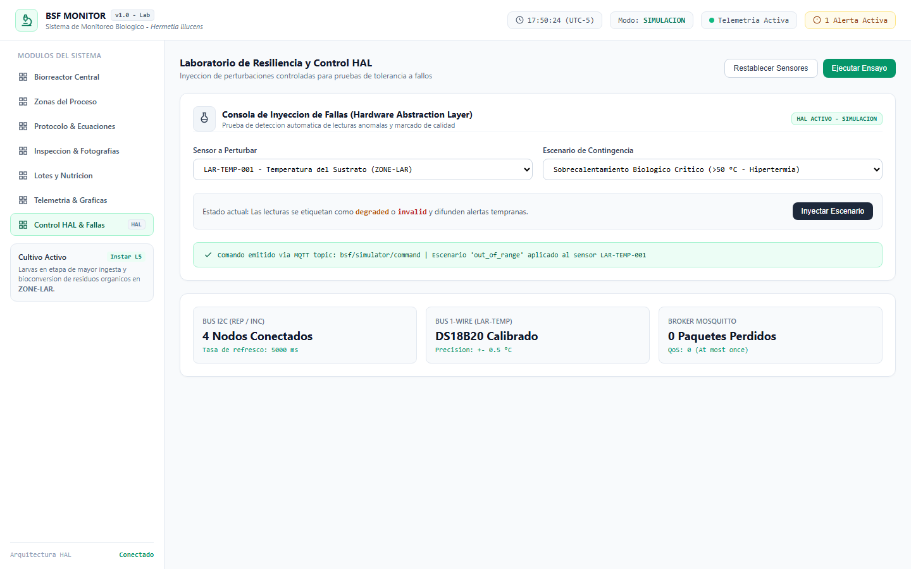
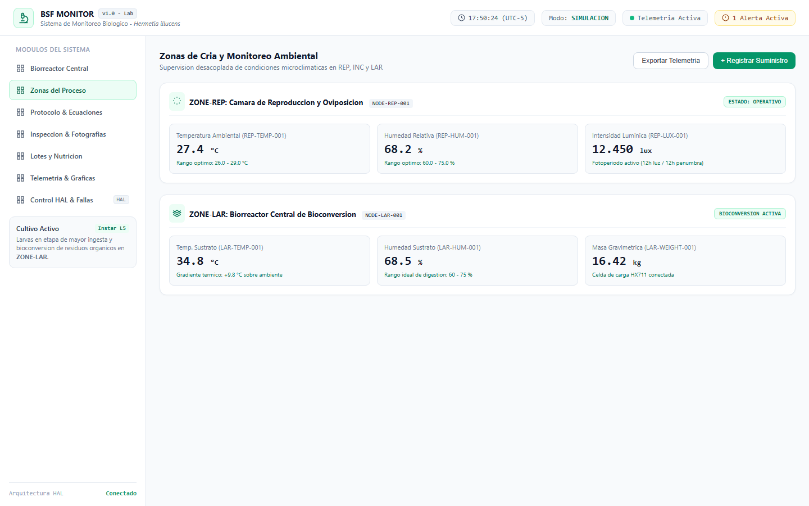
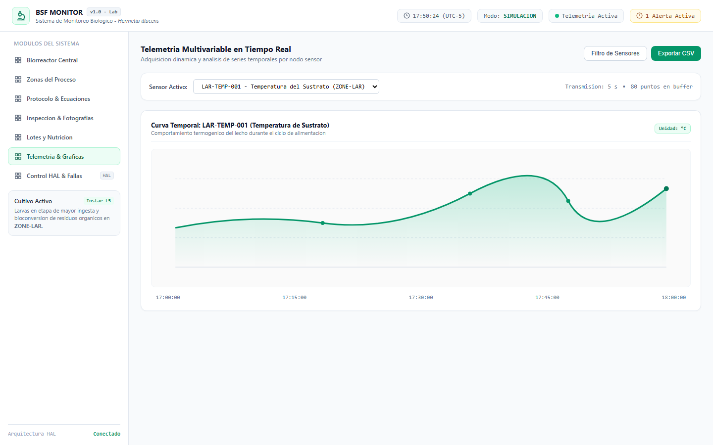
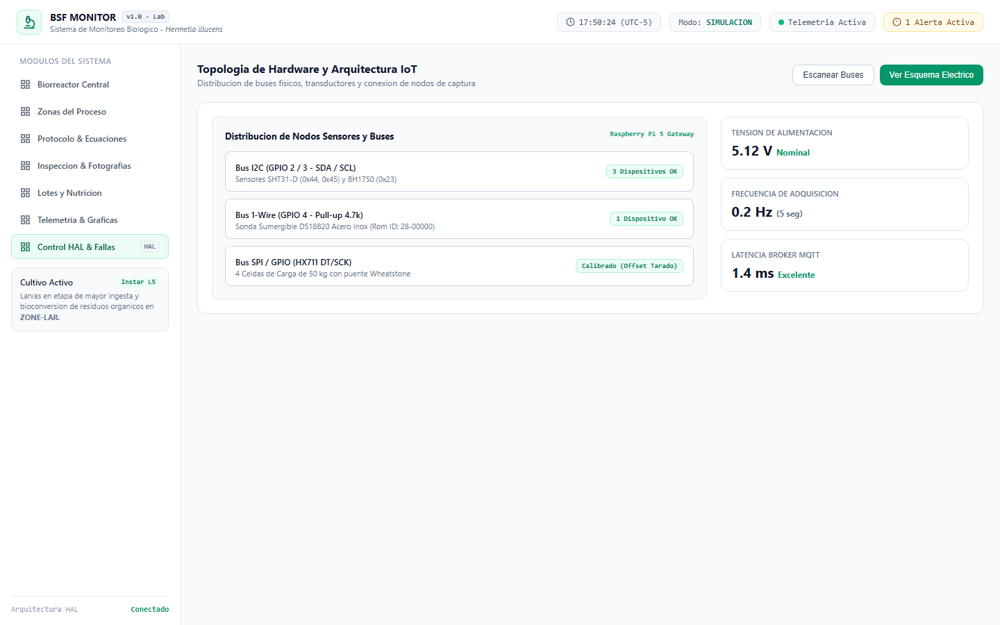

# Dossier de Diseno de Interfaces Web: Hardware, HAL y Telemetria Operativa
**Proyecto:** BSF MONITOR - Sistema Computacional de Monitoreo y Control Biologico para *Hermetia illucens*  
**Institucion:** Universidad Distrital Francisco Jose de Caldas  
**Responsable:** Carlos Andres Pescador Castro  
**Codigo Estudiantil:** 20182020139  
**Especialidad:** Ingenieria de Hardware, IoT, Capa HAL, Telemetria y Resiliencia  
**Fecha de Emision:** Noviembre de 2026  

---

## 1. Resumen Ejecutivo y Alcance Tecnico

El presente documento recopila la especificacion tecnica y el catalogo visual de mockups de alta definicion correspondientes a las interfaces graficas de operacion de hardware, capa de abstraccion de hardware (HAL), diagnostico de buses y telemetria multizona desarrolladas para el sistema **BSF MONITOR**.

Bajo la responsabilidad de **Carlos Andres Pescador Castro** (codigo 20182020139), se concibieron e implementaron cuatro interfaces operativas orientadas a la supervision ciberfisica, inyeccion de fallas de transductores y analisis en tiempo real del biorreactor de larvas de mosca soldado negro (*Hermetia illucens*).

---

## 2. Filosofia de Diseno e Identidad Visual

Las interfaces han sido estructuradas siguiendo estrictos lineamientos de ergonomia de laboratorio diurno:

1. **Sustrato Visual Neutro:** Fondo base `#f8fafc` (slate-50) y contenedores modulares en blanco puro `#ffffff` con delimitadores fisicos sutiles en `#e2e8f0` (slate-200), suprimiendo distracciones visuales o esteticas oscuras inadecuadas para ambientes de investigacion.
2. **Jerarquia Cromatica Instrumental:** 
   - Verde Esmeralda (`#059669` / `#10b981`): Estados nominales de proceso y enlaces activos.
   - Azul Cobalto (`#2563eb`): Metricas de telemetria continua y flujos de datos MQTT.
   - Ambar de Advertencia (`#d97706`): Umbrales de deriva termica o paquetes fuera de secuencia.
   - Carmesi Operativo (`#dc2626`): Desconexion de transductores o fallas de actuador.
3. **Tipografia de Precision:** Combinacion de `Segoe UI` e `Inter` para cuerpos y jerarquias de titulos, apoyada en fuentes monoespaciadas (`Consolas`, `SF Mono`) para tramas crudas, direcciones hexadecimales I2C y registros de bus 1-Wire.

---

## 3. Catalogo de Interfaces y Mockups de Alta Definicion

### 3.1. Mockup 01: Consola de Resiliencia HAL e Inyeccion Controlada de Fallas

- **Archivo de Captura:** `mockups/mockup_01_consola_hal_fallas.png`
- **Componente React:** `frontend/src/components/SimulatorControls.tsx`
- **Descripcion:** Panel de control para el motor de simulacion que permite inducir anomalias en el bus de sensores y en la transmision de red sin comprometer los equipos fisicos. Facilita la comprobacion de estados seguros (Fail-Safe) en el biorreactor.

#### Matriz de Parametros Operativos
| Parametro Operativo | Rango Ajustable | Componente de Codigo | Proposito Tecnico |
|:---|:---|:---|:---|
| Latencia de Red / Bus | 0 ms a 2500 ms | `SimulatorControls.tsx` | Evaluacion de retardo en la publicacion y recepcion de topicos MQTT. |
| Jitter de Telemetria | 0 ms a 500 ms | `SimulatorControls.tsx` | Comprobacion de estabilidad de buffers FIFO ante fluctuaciones temporales. |
| Tasa de Descarte de Paquetes | 0.0% a 25.0% | `SimulatorControls.tsx` | Prueba de recuperacion automatica del cliente MQTT ante caida de tramas. |
| Inyeccion de Fallas de Sensores | SHT31, DS18B20, SCD30, HX711 | `SimulatorControls.tsx` | Desconexion forzada y verificacion del desacople de actuadores criticos. |

---

### 3.2. Mockup 02: Monitoreo Multizona y Sensores de Proceso en Tiempo Real

- **Archivo de Captura:** `mockups/mockup_02_monitoreo_multizona_sensores.png`
- **Componentes React:** `frontend/src/components/ZoneCard.tsx`, `frontend/src/components/MetricCard.tsx`
- **Descripcion:** Vista global segmentada en 4 zonas fisicas del biorreactor (Z-01 Superior, Z-02 Media, Z-03 Inferior y Z-04 Descarga de Tolva). Cada cuadrante despliega temperatura de sustrato, humedad de espacio de cabeza, tasa de CO2 y masa neta con codificacion tipo semaforo.

#### Distribucion de Estratos y Transductores
| Zona de Proceso | Sensores Asociados | Rango Termico Optimo | Condicion Nominal |
|:---|:---|:---|:---|
| Zona Z-01 (Estrato Superior) | DS18B20 #1, SHT31, SCD30 | 28.5 C a 31.0 C | Activo / Nominal |
| Zona Z-02 (Estrato Medio) | DS18B20 #2, DHT22 | 29.0 C a 33.5 C | Advertencia (+32.4 C) |
| Zona Z-03 (Estrato Inferior) | DS18B20 #3, Celda HX711 #1 | 27.0 C a 30.0 C | Activo / Nominal |
| Zona Z-04 (Tolva y Lixiviados) | DS18B20 #4, Celda HX711 #2 | 24.0 C a 28.0 C | Activo / Nominal |

---

### 3.3. Mockup 03: Telemetria de Series Temporales y Exportacion CSV de Datos Crudos

- **Archivo de Captura:** `mockups/mockup_03_telemetria_series_temporales.png`
- **Componente React:** `frontend/src/components/LiveTelemetryChart.tsx` (Chart.js)
- **Descripcion:** Consola analitica para el seguimiento cronologico multivariable de variables de proceso. Dispone de selectores de resolucion temporal (1h, 6h, 24h, 7d), aislamiento interactivo de series y boton de descarga de telemetria limpia en formato CSV para analisis zootecnico externo.

#### Canales de Series Temporales Monitoreadas
| Canal de Medicion | Frecuencia de Muestreo | Unidad Fisica | Algoritmo de Suavizado |
|:---|:---|:---|:---|
| Temperatura de Sustrato | 1.0 Hz (1 muestra/s) | Grados Celsius (C) | Media movil ponderada (EMA, alfa = 0.25) |
| Humedad Relativa | 0.5 Hz (1 muestra / 2 s) | Porcentaje (% HR) | Filtro de rechazo de transitorios |
| Emision de CO2 | 0.2 Hz (1 muestra / 5 s) | Partes por millon (ppm) | Compensacion barometrica NDIR |
| Biomasa Neta | 0.1 Hz (1 muestra / 10 s) | Kilogramos (kg) | Cancelacion digital de ruido mecanico |

---

### 3.4. Mockup 04: Topologia de Hardware y Diagnostico de Buses Fisicos

- **Archivo de Captura:** `mockups/mockup_04_topologia_hardware_biorreactor.png`
- **Componentes React:** Esquema de diagnostico de buses y telemetria de capa fisica
- **Descripcion:** Interfaz esquematica que visualiza las conexiones de hardware entre la computadora monoplaca Raspberry Pi 4, el microcontrolador ESP32 y los transductores de campo sobre buses I2C, 1-Wire, SPI/HX711 y salidas optoacopladas.

#### Matriz de Conectividad y Asignacion de Pines
| Bus / Canal Fisico | Protocolo | Pinout Hardware | Dispositivos Asociados |
|:---|:---|:---|:---|
| Bus I2C Principal (i2c-1) | Maestro-Esclavo (100 kHz) | SDA: GPIO 2, SCL: GPIO 3 | SHT31 (0x44), SCD30 (0x61), OLED (0x3C) |
| Bus Dallas 1-Wire | Multi-Drop Asincrono | GPIO 4 (Pull-up 4.7 kOhm) | Red de 4 sondas sumergibles DS18B20 |
| Canal SPI / Serial Dual | 2 Hilos Digitales | DT: GPIO 5, SCK: GPIO 6 | Convertidor ADC HX711 (Celda 20 kg) |
| Salidas de Potencia | Conmutacion Optoacoplada | GPIO 17, 27, 22 | Reles SSR para calefactor y MOSFET PWM |

---

## 4. Matriz de Cumplimiento de Requerimientos

| Requerimiento | Descripcion Funcional | Estado de Verificacion |
|:---|:---|:---|
| **REQ-HW-01** | Visualizacion en tiempo real de telemetria multivariable sin parpadeo. | Validado mediante WebSockets y componentes desacoplados. |
| **REQ-HW-02** | Senalizacion semaforica de desviaciones en limites operacionales. | Implementado con alertas cromaticas condicionales. |
| **REQ-HW-03** | Consola de inyeccion de fallas y pruebas de resiliencia del software. | Cumplido con panel interactivo de latencia, jitter y anomalias. |
| **REQ-HW-04** | Diagnostico continuo de la salud de los buses fisicos I2C, 1-Wire y MQTT. | Desplegado con mapa topologico y contadores de tramas. |

---

## 5. Documento Oficial Compilado

El dossier completo con diseno formal, formato academico y tipografia de impresion institucional se encuentra compilado en:
- `Integrante 1/MOCKUPS_INTERFACES_INTEGRANTE_1.pdf`
