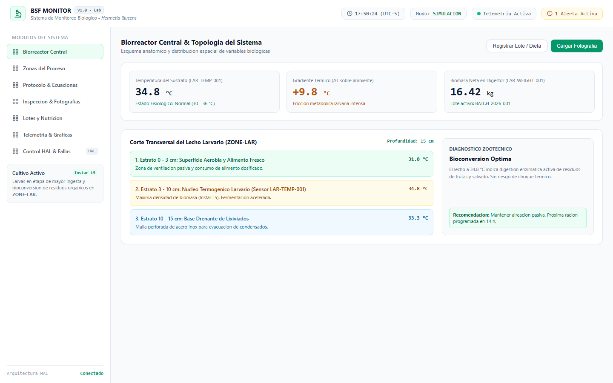
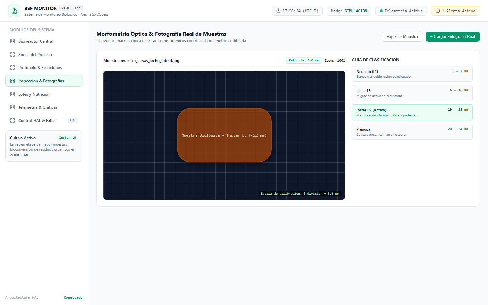
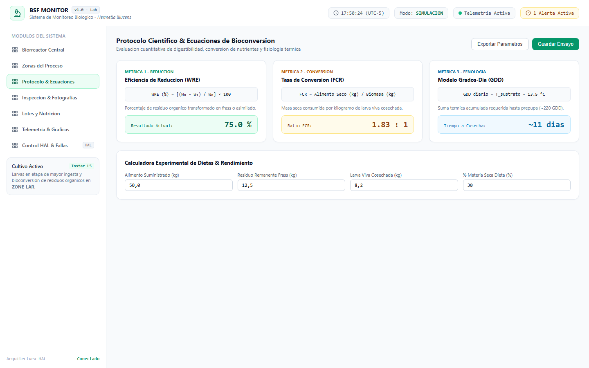
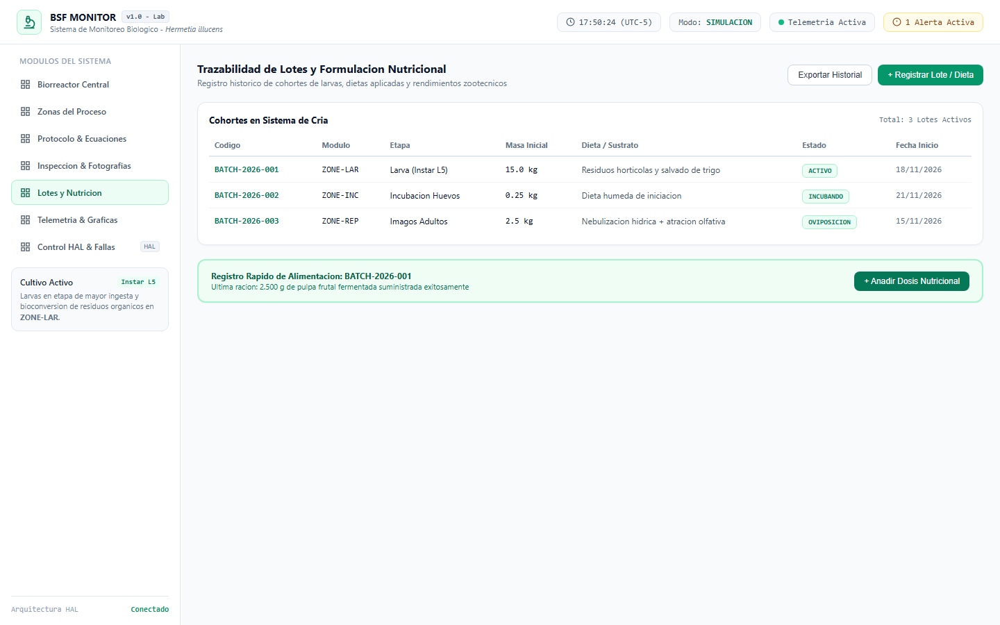

# Dossier de Diseno de Interfaces Web: UX/UI, Gemelo Digital y Analitica Zootecnica
**Proyecto:** BSF MONITOR - Sistema Computacional de Monitoreo y Control Biologico para *Hermetia illucens*  
**Institucion:** Universidad Distrital Francisco Jose de Caldas  
**Responsable:** Miguel Alejandro Chavez Porras  
**Codigo Estudiantil:** 20212020033  
**Especialidad:** Diseno de Experiencia de Usuario (UX), Interfaz Grafica (UI), Gemelo Digital y Trazabilidad  
**Fecha de Emision:** Noviembre de 2026  

---

## 1. Resumen Ejecutivo y Alcance de Experiencia de Usuario

El presente documento detalla la formulacion conceptual, ergonomica y tecnica de las interfaces graficas de usuario y la arquitectura de experiencia de usuario (UX/UI) elaboradas para la plataforma **BSF MONITOR**.

Bajo la responsabilidad de **Miguel Alejandro Chavez Porras** (codigo 20212020033), se disenaron cuatro paneles interactivos especializados para investigacion zootecnica: el **Gemelo Digital tridimensional de 3 niveles**, la **estacion de morfometria optica asistida**, la **bitacora de investigacion y calculadora de ecuaciones biologicas**, y el **sistema de trazabilidad integral de lotes y dietas**.

---

## 2. Criterios de Accesibilidad y Arquitectura de Informacion

La experiencia visual fue construida sobre los siguientes pilares de diseno:

1. **Jerarquia Visual Despejada:** Empleo de contenedores en tarjetas claras con sombra tenue (`box-shadow: 0 1px 3px rgba(0,0,0,0.05)`), bordes precisos en escala de grises slate y supresion absoluta de paletas oscuras o de estilo neon que fatigan al investigador.
2. **Conformidad de Contraste WCAG 2.1 Nivel AA:** Todos los elementos textuales, leyendas de ejes y datos numericos superan el ratio minimo de contraste de 4.5:1 frente a sus fondos inmediatos.
3. **Flujo Operativo Orientado al Investigador:** Organizacion de la navegacion por niveles de abstraccion: vista panoramica global (Dashboard), diagnostico morfologico micro (Morfometria), formalizacion matematica (Protocolos) y registro de trazabilidad (Lotes).

---

## 3. Catalogo de Interfaces y Mockups de Alta Definicion

### 3.1. Mockup 01: Dashboard Central y Gemelo Digital de 3 Niveles del Biorreactor

- **Archivo de Captura:** `mockups/mockup_01_dashboard_gemelo_digital.png`
- **Componentes React:** `frontend/src/components/BioreactorDigitalTwin.tsx`, `frontend/src/components/BioreactorCoreWidget.tsx`
- **Descripcion:** Pantalla principal de mando que presenta la representacion ciberfisica del biorreactor cilíndrico seccionado en 3 niveles de sustrato (superior, medio, profundo). Despliega en tiempo real gradientes termicos estratificados, indicadores KPI de conversion y el estado operativo de los actuadores de climatizacion.

#### Componentes del Gemelo Digital
| Modulo de Interfaz | Componente React | Variable Monitoreada | Control de Usuario |
|:---|:---|:---|:---|
| Corte Estratificado del Biorreactor | `BioreactorDigitalTwin.tsx` | Temperatura por nivel (31.2 C, 32.4 C, 29.8 C) | Seleccion de estrato para detalle termico. |
| Consola de Actuadores | `BioreactorCoreWidget.tsx` | Ventilador PWM (65%), Calefactor (OFF), Humidificador (ON) | Conmutacion Auto / Manual y selector de potencia. |
| Tarjetas Resumen de Rendimiento | `MetricCard.tsx` | Biomasa estimada (14.2 kg), Indice FCR (1.82) | Acceso rapido a balances de masa. |

---

### 3.2. Mockup 02: Estacion de Morfometria Optica y Clasificacion Ontogenica

- **Archivo de Captura:** `mockups/mockup_02_estacion_morfometria_optica.png`
- **Componente React:** `frontend/src/components/MacroInspectionViewer.tsx`
- **Descripcion:** Modulo de vision asistida para el analisis dimensional de larvas en caja de muestreo. Integra una reticula milimetrica calibrada (grilla de paso 5.0 mm), deteccion automatica de especimenes, clasificacion del estadio de metamorfosis (L1 a L6, prepupa, pupa) y calculo biometrico de distribucion de tamano.

#### Parametros Biometricos y Morfologicos
| Elemento Grafico | Especificacion Tecnica | Metrica Obtenida | Rango Tipico |
|:---|:---|:---|:---|
| Reticula Calibrada | Grilla vectorial de paso 5.0 mm | Referencia espacial metrologica | Resolucion 0.1 mm |
| Deteccion de Larvas | Cuadros delimitadores verdes | Conteo de especimenes en la muestra | 20 a 50 larvas por plano |
| Clasificador Ontogenico | Modelo de segmentacion de color y tamano | % poblacional por estadio larval | Dominancia en estadio L5 (62%) |
| Biometria Longitudinal | Longitud promedio y diametro cefalico | Crecimiento diario acumulado | 18.5 mm +/- 1.4 mm |

---

### 3.3. Mockup 03: Bitacora de Ensayos y Calculadora de Bioconversion Zootecnica

- **Archivo de Captura:** `mockups/mockup_03_bitacora_ecuaciones_bioconversion.png`
- **Componente React:** `frontend/src/components/ExperimentalProtocol.tsx`
- **Descripcion:** Cuaderno cientifico digital que formaliza los fundamentos biotecnologicos del proyecto. Expone las ecuaciones matematicas de Reduccion de Residuos (WRE), Factor de Conversion Alimenticia (FCR) y Grados-Dia de Desarrollo (GDD), acopladas a una calculadora dinamica de balance de masas.

#### Formulacion Zootecnica Integrada
| Indicador Zootecnico | Ecuacion Matematica | Parametros de Entrada | Rango Operativo Esperado |
|:---|:---|:---|:---|
| Eficiencia de Reduccion de Residuos (WRE) | `WRE (%) = [(W_in - W_res) / W_in] * 100` | Masa inicial sustrato, residuo final seco | 60.0% a 78.0% |
| Tasa de Conversion Alimenticia (FCR) | `FCR = Alimento Ingerido (kg) / Ganancia de Peso (kg)` | Alimento neto consumido, peso larvario final | 1.4 a 2.1 kg/kg |
| Grados-Dia de Desarrollo (GDD) | `GDD = Sumatoria [(T_promedio - T_base) * dias]` | Historial termico diario (T_base = 13.5 C) | 390 a 440 GDD hasta prepupa |

---

### 3.4. Mockup 04: Trazabilidad de Lotes de Produccion y Gestion de Dietas

- **Archivo de Captura:** `mockups/mockup_04_trazabilidad_lotes_dietas.png`
- **Componente React:** `frontend/src/components/BatchManagerModal.tsx`
- **Descripcion:** Consola para la supervision de cohortes zootecnicas desde la siembra de neonatos hasta la etapa prepupal. Permite registrar formulaciones alimentarias (bagazos, pulpas citricas, estiercol), tasas de mortalidad proyectada y verificacion de balances de cierre previo a cosecha.

#### Matriz de Auditoria de Lote
| Variable de Auditoria | Ejemplo en Pantalla | Validacion de Software | Destino de Datos |
|:---|:---|:---|:---|
| Identificador de Lote | `LOT-2026-HI-042` | Clave primaria unica no repetible | Tabla relacional `production_batches` |
| Dieta de Alimentacion | Bagazo de Malta 60% + Orujo Citrico 40% | Control de consistencia estequiometrica | Registro de balance de carbono/nitrogeno |
| Estado de Metamorfosis | Larva L5 (Dia 12 de ciclo) | Confirmado con modulo de morfometria | Alerta de transicion a prepupa |
| Supervivencia Proyectada | 94.2% poblacional | Estimacion basada en estres termico | Proyeccion de rendimiento de harina |

---

## 4. Matriz de Cumplimiento de Requerimientos UX/UI

| Requerimiento | Descripcion Funcional | Estado de Verificacion |
|:---|:---|:---|
| **REQ-UI-01** | Paneles diferenciados para monitoreo operativo, seguimiento biologico y alertas. | Implementado mediante estructura modular de componentes. |
| **REQ-UI-02** | Gemelo digital interactivo con representacion espacial y termica del biorreactor. | Validado con corte de 3 estratos y panel de actuadores. |
| **REQ-UI-03** | Estacion de morfometria optica con reticula calibrada y conteo ontogenico. | Desplegado con viewport macroscopico y clasificacion L1-L6. |
| **REQ-UI-04** | Bitacora experimental con ecuaciones zootecnicas y calculadora reactiva. | Incorporado con formulas WRE, FCR, GDD y balance de masas. |

---

## 5. Documento Oficial Compilado

El dossier completo con diseno formal, formato academico y tipografia de impresion institucional se encuentra compilado en:
- `Integrante 2/MOCKUPS_INTERFACES_INTEGRANTE_2.pdf`
