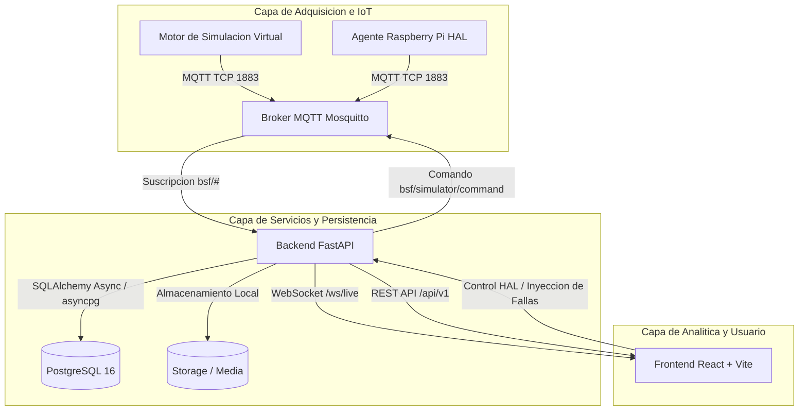

# BSF MONITOR

Plataforma IoT y Software de Investigacion para Adquisicion, Almacenamiento, Analitica y Control en la Cria de Mosca Soldado Negra (*Hermetia illucens*) en Biorreactor.

[](LICENSE)
[](https://www.python.org/)
[](https://fastapi.tiangolo.com/)
[](https://react.dev/)
[](https://www.docker.com/)

---

## 1. Vision y Alcance del Proyecto

BSF MONITOR es una solucion integral orientada tanto a entornos de investigacion entomologica como a plantas piloto de bioconversion de residuos organicos. El sistema supervisa y orquesta las tres zonas criticas del ciclo biológico de *Hermetia illucens*:

1. **Zona de Reproduccion (`ZONE-REP`)**: Monitoreo de camaras de vuelo de imagos (adultos). Control de fotoperiodo, intensidad luminica natural/artificial inductora del cortejo, temperatura ambiental y humedad para estimular la oviposicion en tablillas alveoladas.
2. **Zona de Incubacion (`ZONE-INC`)**: Camara hermetica de eclosion de posturas. Control de humedad relativa de saturacion para prevenir deshidratacion embrionaria y seguimiento termico hasta el nacimiento de larvas neonatas (L1).
3. **Zona de Larvas / Biorreactor Central (`ZONE-LAR`)**: Biorreactor de lecho dinamico para digestion voraz de sustratos organicos por estadios L4-L5. Monitoreo continuo de temperatura interna del lecho (termogenesis larvaria), temperatura ambiental, humedad de masa, balance gravimetrico continuo (celdas de carga) y diagnostico visual macroscopico.

### Principio de Arquitectura: Simulacion Integral Previa

El desarrollo se fundamenta en la premisa **"Simulacion antes de adquisicion"**:
- El sistema cuenta con una Capa de Abstraccion de Hardware (**HAL**) desacoplada.
- Antes de conectar sensores fisicos a buses GPIO/I2C/1-Wire de una Raspberry Pi, el motor de simulacion (`simulator/engine.py`) genera curvas diurnas fisiologicamente realistas con ruido gaussiano, variaciones estacionales e inyeccion de contingencias operativas (desconexion de bus, sensor congelado, descalibracion o hipertermia critica).
- El backend y el frontend procesan, persisten y visualizan lecturas sin distincion entre el entorno de simulacion y el hardware fisico.

---

## 2. Arquitectura General del Sistema



---

## 3. Topologia de Sensores y Variables por Zona

| Zona | ID Sensor | Variable Fisica | Protocolo / Bus | Sensor Fisico | Rango Nominal | Frecuencia |
|---|---|---|---|---|---|---|
| `ZONE-REP` | `REP-TEMP-001` | Temperatura ambiental | I2C | SHT31-D / DHT22 | 26.0 - 29.0 C | 5 s |
| `ZONE-REP` | `REP-HUM-001` | Humedad relativa | I2C | SHT31-D | 60.0 - 75.0 % | 5 s |
| `ZONE-REP` | `REP-LUX-001` | Intensidad luminica | I2C | BH1750 | 10.000 - 15.000 lux | 5 s |
| `ZONE-INC` | `INC-TEMP-001` | Temperatura incubacion | I2C | SHT31-D | 28.0 - 30.0 C | 5 s |
| `ZONE-INC` | `INC-HUM-001` | Humedad camara | I2C | SHT31-D | 70.0 - 85.0 % | 5 s |
| `ZONE-LAR` | `LAR-TEMP-001` | Temperatura de sustrato | 1-Wire | DS18B20 sumergible | 30.0 - 38.0 C | 5 s |
| `ZONE-LAR` | `LAR-HUM-001` | Humedad de sustrato | I2C / Analog | Sensor capacitivo | 60.0 - 75.0 % | 5 s |
| `ZONE-LAR` | `LAR-WEIGHT-001`| Masa total del lecho | SPI / GPIO | Celda de carga + HX711 | 0.0 - 50.0 kg | 5 s |
| `ZONE-LAR` | `CAM-LAR-001` | Morfometria y muestras | CSI / USB | Raspberry Pi Cam v3 / Web | Imagen real | Manual / Programado |

---

## 4. Modelado Biologico y Metricas Zoocientificas

La plataforma incorpora formulaciones estandarizadas en entomologia aplicada:

### A. Eficiencia de Reduccion de Residuos (WRE - Waste Reduction Efficiency)
Cuantifica la capacidad digestiva de la colonia:
$$\text{WRE (\%)} = \left[ \frac{W_0 - W_1}{W_0} \right] \times 100$$
Donde $W_0$ es la masa seca o humeda de alimento suministrado y $W_1$ es el frass o compost remanente no digerido.

### B. Factor de Conversion Alimenticia (FCR - Feed Conversion Ratio)
$$\text{FCR} = \frac{\text{Alimento Suministrado (kg MS)}}{\text{Biomasa Larvaria Ganada (kg VF)}}$$
Un FCR inferior a 2.0 representa una conversion nutricional de alto rendimiento.

### C. Acumulacion Termica de Grados-Dia (GDD - Growing Degree Days)
Modelo fenologico para predecir el momento exacto de aparicion de prepupas y cosecha:
$$\text{GDD}_{\text{diario}} = \max(0, T_{\text{sustrato}} - T_{\text{base}})$$
Para *Hermetia illucens*, la temperatura fisiologica basal es $T_{\text{base}} = 13.5^\circ\text{C}$. Se requieren aproximadamente $220\text{ GDD}$ acumulados para completar la transicion desde neonato L1 hasta prepupa recolectable.

### D. Gradiente Termico Larvario ($\Delta T$)
$$\Delta T = T_{\text{sustrato}} - T_{\text{ambiente}}$$
Indica actividad metabolica aerobia y calor de friccion biomasica. Un rango optimo se situa entre $+6.0^\circ\text{C}$ y $+12.0^\circ\text{C}$ por encima del aire circundante.

---

## 5. Estructura de Directorios

```text
.
|-- backend/
|   |-- app/
|   |   |-- core/              # Configuracion global, variables de entorno y logger
|   |   |-- database/          # Sesion asincrona SQLAlchemy y configuracion PostgreSQL
|   |   |-- models/            # Entidades ORM (zones, devices, sensors, readings, batches)
|   |   |-- mqtt/              # Cliente asincrono MQTT consumidor de telemetria
|   |   |-- repositories/      # Capa de acceso a datos para series temporales
|   |   |-- routers/           # Endpoints REST (system, zones, sensors, batches, media)
|   |   |-- schemas/           # Esquemas Pydantic v2 para validacion de contratos
|   |   |-- websocket/         # Hub de difusion de telemetria en tiempo real
|   |   `-- main.py            # Entrypoint ASGI FastAPI
|   |-- tests/                 # Suite de pruebas automatizadas con pytest
|   |-- Dockerfile             # Imagen Docker multi-stage para Python 3.12-slim
|   `-- requirements.txt       # Dependencias de produccion
|-- frontend/
|   |-- src/
|   |   |-- components/        # Componentes modulares de interfaz limpia diurna
|   |   |-- services/          # Clientes API REST y conexion WebSocket
|   |   |-- types/             # Definiciones e interfaces de TypeScript
|   |   |-- App.tsx            # Orquestador y selector de modulos de investigacion
|   |   |-- index.css          # Estilos de diseno de laboratorio (.clean-card)
|   |   `-- main.tsx           # Entrypoint React 19
|   |-- Dockerfile             # Build Vite y servidor Nginx alpine
|   |-- nginx.conf             # Proxy inverso y enrutamiento SPA
|   |-- package.json           # Dependencias Node.js
|   `-- tailwind.config.js     # Tokens de diseno, paleta slate y acentos esmeralda
|-- simulator/
|   |-- engine.py              # Bucle continuo de generacion de telemetria IoT
|   `-- Dockerfile             # Contenedor de ejecucion para el simulador
|-- raspberry/
|   `-- hal/
|       |-- base.py            # Interfaces abstractas, DTOs y enumeraciones
|       |-- virtual_sensors.py # Sensores virtuales con curvas senoidales y ruido
|       |-- camera.py          # Abstraccion para captura y tratamiento de imagenes
|       `-- physical_sensors.py# Controladores para buses I2C, 1-Wire y celdas HX711
|-- database/
|   `-- init/
|       |-- 01_init_schema.sql # Esquema DDL relacional con llaves foraneas e indices
|       `-- 02_initial_seeds.sql# Semillas con zonas, dispositivos, sensores y lotes
|-- storage/
|   `-- media/
|       |-- captures/          # Capturas programadas
|       `-- uploads/           # Fotografias reales indexadas por investigadores
|-- docs/                      # Especificaciones arquitectonicas, diagramas y ADRs
|-- docker-compose.yml         # Orquestacion de los 5 contenedores del stack
`-- README.md                  # Documentacion principal
```

---

## 6. Despliegue y Ejecucion

### Requisitos Previos
- Docker Desktop v24+ con Docker Compose v2+.
- Puerto libre en host:
  - `5173`: Interfaz web (Frontend).
  - `8000`: API REST / WebSockets / Documentacion OpenAPI.
  - `1883`: Broker MQTT (TCP).
  - `9001`: Broker MQTT (WebSockets).
  - `5432`: PostgreSQL.

### Puesta en Marcha en Modo Simulacion

1. Asegurar la configuracion de entorno para simulacion:
   ```bash
   # En Windows PowerShell o Linux Bash:
   cp .env.example .env.simulation
   ```

2. Construir e iniciar el stack de contenedores:
   ```bash
   docker compose --env-file .env.simulation up -d --build
   ```

3. Verificar que los 5 contenedores se encuentren en estado saludable:
   ```bash
   docker compose ps
   ```

4. Puntos de Entrada:
   - **Plataforma Web de Investigacion**: [http://localhost:5173](http://localhost:5173)
   - **Documentacion Interactiva Swagger**: [http://localhost:8000/docs](http://localhost:8000/docs)
   - **Estado Operativo del Backend**: [http://localhost:8000/api/v1/system/status](http://localhost:8000/api/v1/system/status)

---

## 7. API REST y Protocolos

### Endpoints Principales

- `GET /api/v1/system/status`: Healthcheck completo del sistema (estado de conexion MQTT, base de datos, zonas y sensores activos).
- `GET /api/v1/system/alerts`: Listado de alertas operativas no resueltas.
- `POST /api/v1/system/simulator/fault`: Inyeccion de fallas en sensores virtuales (`disconnected`, `frozen`, `out_of_range`, `clear`).
- `GET /api/v1/zones`: Inventario de zonas de cultivo con sus respectivos sensores y ultima lectura registrada.
- `GET /api/v1/sensors/{sensor_id}/readings?limit=80`: Serie temporal historica para generacion de graficos.
- `GET /api/v1/batches`: Registro y trazabilidad de lotes de larvas.
- `POST /api/v1/batches`: Creacion de un nuevo lote de produccion.
- `POST /api/v1/batches/{batch_id}/feedings`: Registro de suministro de alimento y composicion de dieta.
- `GET /api/v1/media`: Catalogo de registros fotograficos de muestras.
- `POST /api/v1/media/upload`: Carga de fotografias reales asociadas a zona y lote.
- `GET /api/v1/media/{media_id}/file`: Descarga y visualizacion del binario de imagen.
- `WS /ws/live`: Flujo bidireccional en tiempo real para recepcion de telemetria y eventos de alerta.

### Estructura de Topicos MQTT

- Telemetria de sensores: `bsf/{zona}/{dispositivo}/{variable}`
  - Ejemplo: `bsf/larvae/NODE-LAR-001/substrate_temperature`
- Heartbeat de nodos: `bsf/devices/{dispositivo}/status`
- Comandos al simulador: `bsf/simulator/command`

---

## 8. Calidad de Software y Pruebas Automatizadas

El proyecto incluye pruebas unitarias y de integracion que validan el comportamiento nominal y bajo perturbaciones de la capa HAL y los endpoints FastAPI.

Para ejecutar la suite de pruebas automatizadas:
```bash
docker exec bsf_backend pytest /app/backend/tests -v
```

Cobertura verificada:
- Verificacion de endpoints del sistema (`test_root_endpoint`, `test_system_status`).
- Evaluacion de sensores virtuales nominales y estadistica de senal (`test_virtual_temperature_sensor_nominal`).
- Tolerancia a fallos: deteccion de desconexion y degradacion de calidad (`test_virtual_temperature_sensor_disconnected_fault`).
- Inyeccion de sobrecalentamiento biologico fuera de rango (`test_virtual_temperature_sensor_out_of_range_fault`).
- Sensores de humedad e histresis ambiental (`test_virtual_humidity_sensor`).
- Simulacion gravimetrica de celda de carga de biomasa (`test_virtual_weight_sensor`).

---

## 9. Licencia

Este proyecto esta licenciado bajo los terminos de la Licencia MIT. Consulta el archivo [LICENSE](LICENSE) para mas detalles.
