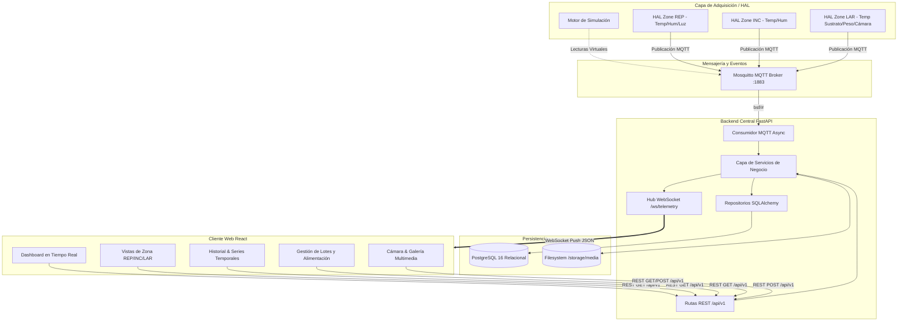

# Arquitectura General del Sistema — BSF MONITOR

## 1. Visión y Principios
BSF MONITOR implementa una arquitectura desacoplada orientada a eventos para la captura de telemetría, almacenamiento inmutable y visualización en tiempo real.

### Principios Fundamentales:
1. **Desacoplamiento HAL**: Los servicios de negocio no conocen detalles de buses físicos (I2C, 1-Wire, SPI, RS-485).
2. **Inmutabilidad de Telemetría**: Las lecturas de sensores son sólo añadibles (append-only) y nunca se modifican.
3. **Dualidad Simulación/Hardware**: El origen de cada dato se etiqueta explícitamente (`source: simulation` o `source: hardware`).

---

## 2. Diagrama de Arquitectura

---

## 3. Capas del Sistema

### 3.1 Capa de Adquisición (HAL)
- Define contratos estándar (`BaseSensor`, `TemperatureSensor`, `HumiditySensor`, `WeightSensor`, `CameraDevice`).
- Provee implementaciones virtuales (`VirtualTemperatureSensor`, etc.) y reales para hardware futuro.

### 3.2 Capa de Transporte de Telemetría (MQTT)
- Tópicos jerárquicos: `bsf/{zone_code}/{variable}` y `bsf/system/{event}`.
- Calidad de Servicio (QoS 1 para mediciones críticas, QoS 0 para telemetría de alta frecuencia).

### 3.3 Capa Backend (FastAPI + SQLAlchemy)
- Consumo asíncrono de tópicos MQTT en background task.
- Validación estricta con Pydantic v2.
- Emisión inmediata a clientes conectados por WebSockets.
- Persistencia asíncrona mediante `asyncpg`.

### 3.4 Capa de Persistencia
- PostgreSQL 16: Almacena entidades maestras (zonas, lotes, dispositivos, sensores) y lecturas (`sensor_readings`).
- Sistema de archivos local montado: `/storage/media/` para imágenes y capturas fotográficas con metadatos asociados en base de datos.

### 3.5 Capa Frontend (React + TypeScript + Tailwind)
- Aplicación SPA desarrollada con Vite.
- Gráficas interactivas con Recharts.
- Conexión persistente WebSocket con reconexión automática y retroalimentación de estado de enlace.
