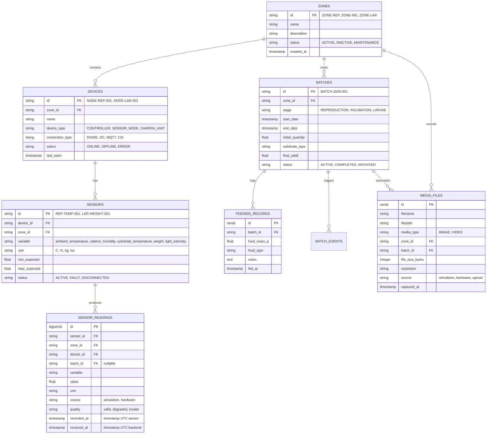

# Modelo de Datos Relacional — BSF MONITOR

La base de datos principal es **PostgreSQL 16**. A continuación se detallan las entidades nucleares del modelo relacional.

## Índices Principales Recomendados
- `sensor_readings(sensor_id, recorded_at DESC)`
- `sensor_readings(zone_id, recorded_at DESC)`
- `sensor_readings(recorded_at DESC)`
- `batches(status, stage)`
- `media_files(zone_id, captured_at DESC)`
