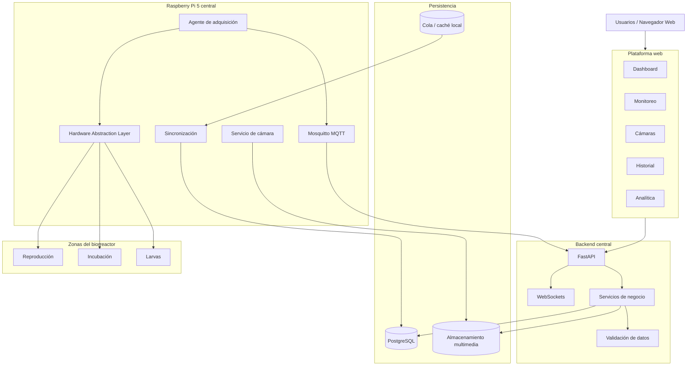

# BSF MONITOR
## Documento maestro de arquitectura, especificaciones técnicas y desarrollo mediante agentes de IA

**Proyecto:** BSF MONITOR  
**Versión del documento:** 1.0  
**Estado:** Especificación inicial  
**Tipo:** Proyecto IoT, monitoreo, simulación, almacenamiento de datos, visión artificial e investigación biológica.  
**Plataforma objetivo:** Raspberry Pi 5 centralizada.  
**Entorno inicial:** Simulación integral antes de adquirir hardware físico.

---

# 1. VISIÓN GENERAL DEL PROYECTO

BSF MONITOR es una plataforma IoT destinada a la supervisión, monitorización, recopilación, almacenamiento y análisis de datos relacionados con la cría de mosca soldado negra (*Hermetia illucens*) y el aprovechamiento de residuos orgánicos mediante sistemas de producción tipo biorreactor.

El sistema debe permitir que los usuarios accedan desde una interfaz web para observar el funcionamiento de las instalaciones, consultar las condiciones ambientales, visualizar cámaras en tiempo real, examinar registros históricos y analizar la evolución de los diferentes lotes de producción.

El proyecto se desarrollará inicialmente mediante simulación integral.

No se requiere adquirir una Raspberry Pi 5 ni sensores físicos para comenzar el desarrollo.

La arquitectura debe permitir sustituir los componentes simulados por componentes físicos sin tener que reconstruir el backend, la interfaz web, la base de datos ni los módulos de analítica.

## 1.1 Objetivo principal

Construir una plataforma integral capaz de:

- Monitorear tres zonas de producción.
- Recopilar automáticamente las mediciones de sensores.
- Visualizar información en tiempo real.
- Consultar históricos de cualquier periodo disponible.
- Visualizar cámaras en directo.
- Almacenar fotografías y archivos multimedia.
- Registrar todos los eventos del proceso.
- Administrar lotes de producción.
- Comparar condiciones ambientales y resultados biológicos.
- Ejecutar experimentos controlados.
- Incorporar posteriormente inteligencia artificial.
- Permitir la migración de simulación a hardware real.

## 1.2 Filosofía de desarrollo

El proyecto debe construirse bajo estos principios:

1. Simulación antes de adquisición de hardware.
2. Arquitectura modular.
3. Separación entre hardware y lógica de negocio.
4. Persistencia confiable de todos los datos.
5. Trazabilidad de mediciones y eventos.
6. Documentación técnica obligatoria.
7. Código mantenible y probado.
8. Seguridad desde el diseño.
9. Escalabilidad progresiva.
10. Reutilización de componentes entre simulación y producción.

**Regla fundamental:** los módulos de la plataforma no deben depender directamente de dispositivos físicos. Deben comunicarse mediante interfaces y contratos de software estables.

---

# 2. ALCANCE FUNCIONAL

## 2.1 Zonas de producción

El sistema tendrá tres zonas iniciales.

### ZONE-REP — Reproducción

Destinada al seguimiento de adultos reproductores.

Variables previstas:

- Temperatura ambiental.
- Humedad relativa.
- Intensidad lumínica.
- Fotoperiodo.
- Duración de iluminación.
- Actividad observada.
- Observaciones del operador.
- Registro fotográfico.
- Eventos de mantenimiento.

### ZONE-INC — Incubación

Destinada al seguimiento de huevos y procesos de eclosión.

Variables previstas:

- Temperatura ambiental.
- Humedad relativa.
- Temperatura del entorno de incubación.
- Tiempo de incubación.
- Fecha de inicio.
- Fecha de eclosión.
- Cantidad estimada de huevos.
- Porcentaje de eclosión.
- Observaciones.
- Fotografías periódicas.

### ZONE-LAR — Larvas

Será la primera zona equipada con cámara.

Variables previstas:

- Temperatura ambiental.
- Humedad relativa.
- Temperatura del sustrato.
- Temperatura en diferentes profundidades.
- Masa del sustrato.
- Masa de alimento suministrado.
- Biomasa estimada.
- Densidad de larvas.
- Frecuencia de alimentación.
- Actividad observada.
- Mortalidad.
- Supervivencia.
- Desarrollo.
- Fotografías.
- Vídeo en directo.

Los parámetros anteriores representan variables de investigación. No se deben asumir valores óptimos universales ni implementar consignas biológicas sin validación experimental.

## 2.2 Funciones de la plataforma web

La plataforma debe incluir:

1. Dashboard general.
2. Monitoreo de reproducción.
3. Monitoreo de incubación.
4. Monitoreo de larvas.
5. Visualización de cámara en directo.
6. Galería de fotografías.
7. Historial de mediciones.
8. Gráficas históricas.
9. Gestión de lotes.
10. Registro de alimentación.
11. Registro de observaciones.
12. Registro de eventos.
13. Comparación de lotes.
14. Análisis experimental.
15. Informes y exportaciones.
16. Estado de dispositivos.
17. Alertas e incidencias.
18. Administración de configuración y accesos.

La administración de usuarios y permisos debe existir como funcionalidad de soporte, pero no debe ser el centro del desarrollo.

La prioridad es la observación del biorreactor y la recopilación de información.

---

# 3. ARQUITECTURA GENERAL

Se implementará una arquitectura modular con separación entre dispositivos, adquisición, procesamiento, almacenamiento y presentación.

## 3.1 Diagrama lógico



## 3.2 Componentes principales

### A. Raspberry Pi 5 central

Responsabilidades:

- Coordinar la adquisición de datos.
- Comunicarse con los nodos de sensores.
- Gestionar la cámara.
- Ejecutar servicios locales.
- Mantener datos temporales cuando no exista conexión.
- Sincronizar datos con el servidor central.
- Informar el estado de los dispositivos.

La Raspberry Pi 5 será el controlador físico principal, pero no se debe obligar a ejecutar todos los servicios de la plataforma en ella.

### B. Backend

Tecnología principal: Python y FastAPI.

Responsabilidades:

- API REST.
- Comunicación WebSocket.
- Validación de mediciones.
- Gestión de lotes.
- Gestión de dispositivos.
- Consultas históricas.
- Gestión de archivos multimedia.
- Alertas.
- Analítica.
- Autenticación y autorización.

### C. Base de datos

Tecnología principal: PostgreSQL.

Responsabilidades:

- Mediciones.
- Sensores.
- Dispositivos.
- Zonas.
- Lotes.
- Eventos.
- Experimentos.
- Observaciones.
- Configuración.
- Alertas.
- Metadatos multimedia.

Se debe evaluar particionamiento temporal para tablas de alto volumen.

### D. Almacenamiento multimedia

Las imágenes y los vídeos no deben almacenarse directamente como grandes objetos dentro de PostgreSQL.

Se utilizará almacenamiento de archivos u objetos.

PostgreSQL conservará:

- Ruta o identificador del archivo.
- Fecha y hora.
- Zona.
- Cámara.
- Lote asociado.
- Tipo de archivo.
- Resolución.
- Tamaño.
- Metadatos.
- Estado de procesamiento.

### E. Comunicación

Tecnologías:

- MQTT para telemetría.
- WebSockets para actualización de la interfaz.
- HTTP/REST para operaciones y consultas.
- RS-485/Modbus para comunicación física con nodos de sensores cuando corresponda.

---

# 4. ARQUITECTURA DE SIMULACIÓN

La simulación será el entorno inicial de desarrollo y pruebas.

Debe representar el comportamiento lógico de los dispositivos, sin afirmar que reproduce eléctricamente todos los componentes físicos de una Raspberry Pi 5.

## 4.1 Modos de operación

Se implementarán dos modos.

### SIMULATION

- Raspberry virtual.
- Sensores virtuales.
- Nodos virtuales.
- Cámara de prueba.
- Datos generados artificialmente.
- Fallos simulados.
- Comunicación MQTT.
- Almacenamiento real en PostgreSQL.
- Dashboard real.
- Historial real.

### PRODUCTION

- Raspberry Pi 5 física.
- Sensores reales.
- Cámara física.
- Nodos físicos.
- Lecturas reales.
- Comunicación MQTT.
- Almacenamiento real.
- Dashboard real.

El modo de operación se debe configurar explícitamente.

No se deben mezclar accidentalmente lecturas simuladas con lecturas reales.

Cada medición debe identificar su origen:

- `simulation`
- `hardware`

## 4.2 Hardware Abstraction Layer (HAL)

Se debe desarrollar una capa de abstracción de hardware.

Esta capa es uno de los componentes más importantes del proyecto.

Su objetivo es permitir sustituir un dispositivo virtual por uno físico manteniendo los mismos contratos de software.

Interfaces necesarias:

```text
TemperatureSensor
HumiditySensor
LightSensor
WeightSensor
EnvironmentalSensor
CameraDevice
CommunicationNode
ActuatorDevice
```

Cada interfaz tendrá implementaciones:

```text
VirtualTemperatureSensor
RealTemperatureSensor

VirtualHumiditySensor
RealHumiditySensor

VirtualWeightSensor
RealWeightSensor

VirtualCamera
RealCamera
```

El resto del sistema debe trabajar exclusivamente con las interfaces.

Ningún servicio de negocio debe importar directamente drivers específicos de GPIO, I2C, SPI o 1-Wire.

## 4.3 Configuración del modo

Se utilizará configuración por variables de entorno y archivos de configuración validados.

Ejemplo:

```env
BSF_MODE=SIMULATION

DATABASE_URL=postgresql://...
MQTT_HOST=mosquitto
MQTT_PORT=1883

CAMERA_MODE=VIRTUAL

SENSOR_POLL_INTERVAL=10

IMAGE_CAPTURE_INTERVAL=300
```

No guardar contraseñas reales dentro del repositorio.

Las configuraciones físicas y simuladas deben estar separadas.

## 4.4 Simulador de sensores

Cada sensor virtual debe poder:

- Generar lecturas.
- Simular variaciones.
- Mantener una unidad.
- Identificar zona.
- Identificar dispositivo.
- Simular errores.
- Desconectarse.
- Recuperarse.
- Generar lecturas inválidas.
- Simular valores fuera de rango.
- Configurar frecuencia de adquisición.

Los valores simulados deben poder ser controlados por escenarios.

Ejemplo de lectura:

```json
{
  "device_id": "NODE-LAR-001",
  "sensor_id": "LAR-TEMP-001",
  "zone_id": "ZONE-LAR",
  "variable": "substrate_temperature",
  "value": 27.4,
  "unit": "C",
  "timestamp": "2026-11-05T15:30:00Z",
  "source": "simulation",
  "quality": "valid"
}
```

El ejemplo es ilustrativo.

## 4.5 Simulación de fallos

Se deben desarrollar escenarios para:

- Sensor desconectado.
- Sensor defectuoso.
- Valor congelado.
- Lectura fuera de rango.
- Nodo sin comunicación.
- Broker MQTT desconectado.
- Pérdida de conexión con el servidor.
- Reinicio de Raspberry.
- Disco sin espacio suficiente.
- Cámara desconectada.
- Archivo multimedia corrupto.
- Pérdida de sincronización horaria.

Los fallos deben generar eventos consultables.

## 4.6 Simulación del biorreactor

El simulador debe representar:

- Tres zonas.
- Lotes.
- Alimentación.
- Cambios de temperatura.
- Cambios de humedad.
- Cambios de iluminación.
- Evolución temporal de biomasa ficticia.
- Eventos de alimentación.
- Mortalidad ficticia.
- Capturas fotográficas.
- Escenarios experimentales.

Los modelos biológicos serán identificados como modelos sintéticos hasta que se calibren con datos experimentales reales.

No presentar predicciones sintéticas como resultados científicos validados.

---

# 5. ARQUITECTURA DE SENSORES

La primera versión debe permitir integrar sensores virtuales y posteriormente sus equivalentes físicos.

## 5.1 Sensores candidatos

| Variable | Sensor candidato | Interfaz |
|---|---|---|
| Temperatura ambiental | SHT31 | I2C |
| Humedad ambiental | SHT31 | I2C |
| Temperatura de sustrato | DS18B20 | 1-Wire |
| Iluminación | BH1750 | I2C |
| Peso | Celda de carga + HX711 | GPIO / interfaz del nodo |
| Cámara | Raspberry Pi Camera Module | CSI |
| Temperatura adicional | DS18B20 | 1-Wire |

Los sensores deben seleccionarse definitivamente después de revisar rangos, precisión, encapsulado, ambiente de operación, distancia y calibración.

## 5.2 Arquitectura de nodos

Se recomienda una arquitectura distribuida de adquisición con una Raspberry Pi central.

Los nodos de zona pueden implementarse con microcontroladores y transceptores RS-485.

```text
Raspberry Pi 5
      |
   RS-485
      |
  --------------
  |      |     |
NODE1  NODE2 NODE3
  |      |     |
 REP    INC   LAR
```

Esto permite reducir cableado largo de sensores hasta la Raspberry.

Se debe definir:

- Dirección de cada nodo.
- Protocolo.
- Frecuencia de consulta.
- Identificación de sensores.
- Tiempo máximo de respuesta.
- Política de reintentos.
- Detección de desconexión.

Los nodos físicos deben tener una implementación equivalente en simulación.

---

# 6. CÁMARA Y SISTEMA MULTIMEDIA

La primera cámara se instalará en ZONE-LAR.

El sistema debe admitir ampliación futura.

## 6.1 Requisitos

- Vídeo en directo desde la web.
- Capturas automáticas.
- Fecha y hora de cada captura.
- Asociación con lote.
- Asociación con zona.
- Galería histórica.
- Descarga de fotografías.
- Configuración de resolución.
- Configuración del intervalo de captura.
- Detección de cámara desconectada.
- Gestión del espacio de almacenamiento.

## 6.2 Separación entre streaming y archivo

El streaming no debe almacenarse automáticamente como una única grabación infinita.

Se implementarán dos servicios independientes:

1. Servicio de vídeo en directo.
2. Servicio de captura y almacenamiento histórico.

La grabación continua se podrá añadir posteriormente con configuración de retención y capacidad.

## 6.3 Simulación de cámara

La cámara virtual debe permitir:

- Utilizar vídeos de prueba.
- Mostrar imágenes estáticas.
- Generar capturas programadas.
- Simular desconexiones.
- Simular fallos de lectura.
- Probar la interfaz de streaming.
- Guardar imágenes con metadatos.

No se debe generar la impresión de que una imagen de prueba proviene de una cámara física.

---

# 7. BASE DE DATOS Y MODELO DE INFORMACIÓN

Se utilizará PostgreSQL como base de datos principal.

## 7.1 Entidades principales

```text
users
roles
zones
devices
sensors
sensor_readings
batches
batch_events
feeding_records
weight_records
observations
experiments
experiment_conditions
camera_devices
media_files
alerts
system_events
maintenance_records
```

## 7.2 Requisitos de las mediciones

Cada lectura debe tener:

- Identificador único.
- Identificador del sensor.
- Identificador del dispositivo.
- Identificador de zona.
- Identificador de lote cuando aplique.
- Variable.
- Valor.
- Unidad.
- Timestamp de adquisición.
- Timestamp de recepción.
- Origen de datos.
- Calidad.
- Metadatos opcionales.

Las mediciones no deben sobrescribirse.

Los errores y correcciones deben quedar trazables.

## 7.3 Integridad temporal

Se debe utilizar UTC para almacenamiento de fechas.

La interfaz debe presentar las fechas en la zona horaria configurada por el usuario o la instalación.

Se debe conservar la diferencia entre:

- Momento de medición.
- Momento de recepción.
- Momento de procesamiento.

Esto permitirá identificar retrasos y problemas de sincronización.

## 7.4 Retención

Debe existir una política configurable de:

- Retención de fotografías.
- Retención de vídeos.
- Retención de logs.
- Retención de mediciones.
- Copias de seguridad.

No se eliminarán registros históricos automáticamente sin una política explícita.

---

# 8. BACKEND

Tecnología principal: Python + FastAPI.

## 8.1 Módulos

```text
backend/
├── app/
│   ├── main.py
│   ├── config/
│   ├── api/
│   ├── models/
│   ├── schemas/
│   ├── repositories/
│   ├── services/
│   ├── database/
│   ├── mqtt/
│   ├── websocket/
│   ├── storage/
│   ├── analytics/
│   ├── alerts/
│   └── security/
├── tests/
└── migrations/
```

## 8.2 API inicial

Endpoints sugeridos:

```text
GET    /api/v1/zones
GET    /api/v1/zones/{zone_id}

GET    /api/v1/sensors
GET    /api/v1/sensors/{sensor_id}
GET    /api/v1/sensors/{sensor_id}/readings

GET    /api/v1/readings
GET    /api/v1/readings/latest

GET    /api/v1/batches
POST   /api/v1/batches
GET    /api/v1/batches/{batch_id}

POST   /api/v1/feeding
GET    /api/v1/feeding

GET    /api/v1/media
POST   /api/v1/media
GET    /api/v1/media/{media_id}

GET    /api/v1/alerts
GET    /api/v1/devices
GET    /api/v1/system/status
```

Los endpoints definitivos deben documentarse mediante OpenAPI.

## 8.3 WebSockets

Se utilizarán para:

- Actualización de lecturas.
- Estado de dispositivos.
- Alertas.
- Eventos.
- Indicadores de conexión.

La conexión WebSocket no reemplaza el almacenamiento histórico.

---

# 9. FRONTEND

El frontend será una aplicación web independiente.

Tecnologías recomendadas:

- React.
- TypeScript.
- Vite.
- Biblioteca de componentes mantenible.
- Librería de gráficas.
- Cliente HTTP.
- Cliente WebSocket.

La selección definitiva de bibliotecas debe documentarse antes de consolidar dependencias.

## 9.1 Estructura de navegación

```text
BSF MONITOR
│
├── Dashboard
│
├── Monitoreo
│   ├── Reproducción
│   ├── Incubación
│   └── Larvas
│
├── Cámara en vivo
│
├── Historial
│   ├── Temperatura
│   ├── Humedad
│   ├── Iluminación
│   └── Peso
│
├── Producción
│   ├── Lotes
│   ├── Alimentación
│   └── Biomasa
│
├── Multimedia
│   ├── Fotografías
│   └── Vídeos
│
├── Analítica
│
├── Experimentos
│
├── Simulador
│
├── Dispositivos
│
└── Configuración
```

## 9.2 Dashboard

Debe mostrar:

- Estado general.
- Estado de cada zona.
- Última medición.
- Sensores desconectados.
- Alertas.
- Lotes activos.
- Acceso a cámaras.
- Indicadores de producción.

Los valores deben indicar si son reales o simulados.

## 9.3 Historial

Debe permitir:

- Seleccionar sensor.
- Seleccionar zona.
- Seleccionar lote.
- Definir intervalo temporal.
- Consultar gráficas.
- Consultar tablas.
- Descargar registros CSV.
- Comparar periodos.

---

# 10. COMUNICACIÓN MQTT

Se utilizará Eclipse Mosquitto.

## 10.1 Convención de tópicos

```text
bsf/reproduction/temperature
bsf/reproduction/humidity
bsf/reproduction/light

bsf/incubation/temperature
bsf/incubation/humidity

bsf/larvae/temperature
bsf/larvae/humidity
bsf/larvae/weight

bsf/larvae/camera/status

bsf/system/device/status
bsf/system/alerts
```

## 10.2 Requisitos

- Identificación de origen.
- QoS apropiado según tipo de mensaje.
- Persistencia cuando sea necesaria.
- Autenticación.
- Control de permisos.
- Detección de dispositivos desconectados.
- Reintentos.
- Manejo de mensajes duplicados.
- Validación de contenido.
- Registro de errores.

Las operaciones de sincronización deben ser idempotentes para evitar duplicar mediciones al recuperar conectividad.

---

# 11. ANALÍTICA Y EXPERIMENTACIÓN

El objetivo científico del proyecto es relacionar las condiciones ambientales con los resultados de producción.

## 11.1 Gestión de lotes

Cada lote debe tener:

- Código único.
- Zona.
- Fecha de inicio.
- Origen.
- Cantidad inicial.
- Tipo de sustrato.
- Cantidad de alimento.
- Densidad inicial.
- Observaciones.
- Fecha de finalización.
- Resultado de producción.

## 11.2 Variables de resultado

- Supervivencia.
- Mortalidad.
- Biomasa final.
- Tiempo de desarrollo.
- Masa individual estimada.
- Consumo de alimento.
- Conversión de sustrato.
- Residuos remanentes.
- Rendimiento.

Las definiciones y fórmulas deben estar documentadas y contar con unidades.

## 11.3 Experimentos

La plataforma debe permitir crear experimentos que definan:

- Hipótesis.
- Lotes involucrados.
- Variables observadas.
- Condiciones experimentales.
- Duración.
- Frecuencia de medición.
- Resultados.
- Conclusiones.

No se debe confundir correlación con causalidad.

Los valores óptimos deberán obtenerse mediante ensayos controlados y evidencia biológica.

---

# 12. SEGURIDAD Y CONFIABILIDAD

Requisitos obligatorios:

- Autenticación.
- Autorización.
- HTTPS para acceso remoto.
- Gestión segura de secretos.
- Protección de API.
- Validación de entradas.
- Logs de auditoría.
- Copias de seguridad.
- Restauración probada.
- Control de acceso a multimedia.
- Protección de servicios MQTT.
- Aislamiento de servicios.
- Gestión de errores.

La Raspberry debe continuar adquiriendo y almacenando datos localmente si se pierde Internet.

Debe existir una cola local de almacenamiento temporal y un proceso de sincronización posterior.

La interfaz debe informar cuándo los datos están retrasados o pendientes de sincronización.

Los servicios físicos de control deben permanecer en estado seguro ante errores.

El sistema de simulación no debe activar nunca actuadores físicos.

---

# 13. ENTORNO DE DESARROLLO Y DESPLIEGUE

Entorno inicial recomendado:

- Windows.
- WSL2.
- Ubuntu.
- Docker.
- Docker Compose.
- Git.

La aplicación debe poder ejecutarse sin Raspberry Pi física.

## 13.1 Servicios Docker

```text
docker-compose.yml

services:
  frontend
  backend
  postgres
  mosquitto
  simulator
  media-service
```

Se podrán añadir servicios adicionales cuando exista una necesidad justificada.

Los servicios deben contar con:

- Health checks.
- Volúmenes persistentes.
- Configuración externa.
- Logs.
- Reinicio controlado.
- Dependencias explícitas.

## 13.2 Entornos

Se crearán configuraciones diferenciadas:

```text
.env.example
.env.development
.env.simulation
.env.production.example
```

Los secretos reales no deben incluirse en Git.

---

# 14. ESTRUCTURA GENERAL DEL REPOSITORIO

Estructura propuesta:

```text
BSF_MONITOR/
│
├── README.md
├── CONTRIBUTING.md
├── LICENSE
├── .gitignore
├── .env.example
├── docker-compose.yml
│
├── backend/
│
├── frontend/
│
├── raspberry/
│
├── hardware/
│
├── simulator/
│
├── infrastructure/
│
├── database/
│
├── storage/
│
├── tests/
│
├── scripts/
│
└── docs/
    ├── README.md
    ├── VISION.md
    ├── REQUIREMENTS.md
    ├── ARCHITECTURE.md
    ├── DATA_MODEL.md
    ├── API_SPECIFICATION.md
    ├── MQTT_SPECIFICATION.md
    ├── HARDWARE_DESIGN.md
    ├── HARDWARE_ABSTRACTION.md
    ├── SIMULATOR_DESIGN.md
    ├── CAMERA_SYSTEM.md
    ├── STORAGE_POLICY.md
    ├── SECURITY.md
    ├── DEPLOYMENT.md
    ├── TESTING.md
    ├── DEVELOPMENT_GUIDE.md
    ├── USER_GUIDE.md
    ├── TROUBLESHOOTING.md
    ├── EXPERIMENTAL_PROTOCOL.md
    ├── DECISIONS/
    ├── diagrams/
    ├── modules/
    └── CHANGELOG.md
```

La estructura puede evolucionar, pero cualquier modificación debe documentarse.

---

# 15. DOCUMENTACIÓN OBLIGATORIA

Los agentes de IA deben crear y mantener toda la documentación técnica necesaria.

No se considera terminado un módulo si su documentación está ausente o desactualizada.

## 15.1 Documentos principales

### README.md
Debe explicar:

- Qué es BSF MONITOR.
- Objetivos.
- Funcionalidades.
- Tecnologías.
- Requisitos.
- Instalación.
- Ejecución.
- Acceso a la aplicación.
- Estado del proyecto.

### ARCHITECTURE.md
Debe contener:

- Arquitectura general.
- Componentes.
- Responsabilidades.
- Comunicación.
- Dependencias.
- Diagramas.
- Flujo de datos.
- Decisiones arquitectónicas.

### REQUIREMENTS.md
Debe definir:

- Requisitos funcionales.
- Requisitos no funcionales.
- Restricciones.
- Criterios de aceptación.
- Prioridades.

### DATA_MODEL.md
Debe documentar:

- Entidades.
- Tablas.
- Relaciones.
- Tipos de datos.
- Unidades.
- Índices.
- Reglas de integridad.
- Estrategia de retención.

### API_SPECIFICATION.md
Debe documentar:

- Endpoints.
- Métodos.
- Parámetros.
- Esquemas.
- Respuestas.
- Errores.
- Autenticación.
- Ejemplos.

### MQTT_SPECIFICATION.md
Debe documentar:

- Tópicos.
- Esquemas de mensajes.
- QoS.
- Identificación.
- Persistencia.
- Reintentos.
- Seguridad.

### HARDWARE_DESIGN.md
Debe documentar:

- Raspberry Pi 5.
- Sensores.
- Nodos.
- Interfaces.
- Conexiones.
- Alimentación.
- Protección.
- Limitaciones.
- Componentes compatibles.

### HARDWARE_ABSTRACTION.md
Debe explicar:

- Interfaces.
- Drivers virtuales.
- Drivers reales.
- Contratos.
- Estrategia de sustitución.
- Pruebas de compatibilidad.

### SIMULATOR_DESIGN.md
Debe documentar:

- Arquitectura del simulador.
- Sensores virtuales.
- Zonas.
- Escenarios.
- Generación de datos.
- Fallos.
- Configuración.
- Limitaciones.

### CAMERA_SYSTEM.md
Debe documentar:

- Cámara.
- Captura.
- Streaming.
- Fotografías.
- Almacenamiento.
- Metadatos.
- Retención.
- Acceso web.

### SECURITY.md
Debe describir:

- Modelo de amenazas.
- Autenticación.
- Autorización.
- Secretos.
- Seguridad de red.
- Acceso remoto.
- Protección de datos.
- Procedimientos ante incidentes.

### DEPLOYMENT.md
Debe explicar:

- Instalación.
- Configuración.
- Docker.
- Desarrollo.
- Simulación.
- Producción.
- Actualización.
- Restauración.

### TESTING.md
Debe describir:

- Pruebas unitarias.
- Pruebas de integración.
- Pruebas de sistema.
- Pruebas de simulación.
- Pruebas de fallos.
- Pruebas de rendimiento.
- Criterios de aceptación.

### USER_GUIDE.md
Debe explicar el funcionamiento de la plataforma para sus usuarios.

### TROUBLESHOOTING.md
Debe contener errores conocidos, diagnósticos y procedimientos de solución.

### CHANGELOG.md
Debe registrar cambios importantes por versión.

## 15.2 Documentación adicional obligatoria por módulo

Cada módulo debe tener:

```text
docs/modules/NOMBRE_DEL_MODULO.md
```

Debe incluir:

- Objetivo.
- Responsabilidades.
- Arquitectura interna.
- Entradas.
- Salidas.
- Dependencias.
- Configuración.
- Interfaces.
- Errores.
- Pruebas.
- Limitaciones.
- Ejemplos.

## 15.3 Registro de decisiones arquitectónicas

Se utilizarán Architecture Decision Records (ADR).

Ubicación:

```text
docs/DECISIONS/
```

Ejemplos:

```text
ADR-001-centralized-raspberry.md
ADR-002-postgresql.md
ADR-003-mqtt-communication.md
ADR-004-hardware-abstraction.md
ADR-005-media-storage.md
ADR-006-simulation-first.md
```

Cada ADR debe explicar:

- Contexto.
- Problema.
- Alternativas.
- Decisión.
- Justificación.
- Consecuencias.

---

# 16. DESARROLLO MEDIANTE AGENTES DE IA

El proyecto será desarrollado con apoyo de agentes de IA.

Los agentes deben trabajar con responsabilidades delimitadas y contratos compartidos.

## 16.1 Agente arquitecto

Responsabilidades:

- Mantener la arquitectura general.
- Revisar dependencias.
- Definir contratos.
- Revisar decisiones técnicas.
- Evitar duplicación de componentes.
- Coordinar integraciones.
- Verificar documentación.

No debe permitir que cada agente cree arquitecturas incompatibles.

## 16.2 Agente backend

Responsabilidades:

- API FastAPI.
- Modelos.
- Esquemas.
- Repositorios.
- Servicios.
- WebSockets.
- Validaciones.
- Pruebas.
- Documentación.

## 16.3 Agente frontend

Responsabilidades:

- React.
- TypeScript.
- Dashboard.
- Gráficas.
- Cámara.
- Historial.
- Navegación.
- Comunicación con backend.
- Diseño adaptable.
- Documentación.

## 16.4 Agente IoT y Raspberry

Responsabilidades:

- Hardware Abstraction Layer.
- Drivers.
- Agente de adquisición.
- MQTT.
- RS-485.
- I2C.
- SPI.
- 1-Wire.
- GPIO.
- Sincronización.
- Documentación de hardware.

Debe implementar primero controladores virtuales.

## 16.5 Agente de simulación

Responsabilidades:

- Raspberry virtual.
- Sensores virtuales.
- Nodos virtuales.
- Escenarios.
- Fallos.
- Simulación ambiental.
- Generación de datos.
- Simulación de lotes.
- Integración MQTT.
- Documentación.

## 16.6 Agente de cámaras y multimedia

Responsabilidades:

- Cámara virtual.
- Cámara física.
- Streaming.
- Capturas.
- Archivos.
- Metadatos.
- Galería.
- Retención.
- Pruebas.

## 16.7 Agente de calidad y documentación

Responsabilidades:

- Pruebas.
- Cobertura.
- Validación de contratos.
- Revisión de seguridad.
- Consistencia documental.
- Actualización de CHANGELOG.
- Revisión de criterios de aceptación.

## 16.8 Reglas de colaboración

1. Los agentes deben consultar la arquitectura antes de programar.
2. Ningún agente puede cambiar contratos compartidos sin documentarlo.
3. Los cambios de base de datos deben incluir migraciones.
4. Los cambios de API deben actualizar OpenAPI y su documentación.
5. Los cambios MQTT deben actualizar su especificación.
6. Los módulos deben incluir pruebas.
7. Los agentes deben evitar duplicar funcionalidades.
8. No se deben introducir dependencias innecesarias.
9. No se deben inventar resultados de pruebas.
10. No se debe afirmar que una función está terminada si no se ha ejecutado y verificado.

---

# 17. FASES DE IMPLEMENTACIÓN

## FASE 0 — Preparación

Objetivo: establecer la estructura del repositorio y los contratos técnicos.

Entregables:

- Estructura de carpetas.
- README.
- Arquitectura.
- Requisitos.
- ADR.
- Configuración Docker.
- Convenciones de código.
- Estrategia de pruebas.

Criterio de aceptación:

El proyecto debe contar con una estructura documentada y reproducible.

## FASE 1 — Backend y base de datos

Objetivo: crear la plataforma de datos.

Entregables:

- FastAPI.
- PostgreSQL.
- Migraciones.
- Modelos.
- API.
- WebSockets.
- Almacenamiento.
- Pruebas.

Criterio de aceptación:

Se deben poder guardar y consultar mediciones y eventos mediante la API.

## FASE 2 — Simulador IoT

Objetivo: reproducir las tres zonas.

Entregables:

- Sensores virtuales.
- Nodos virtuales.
- Comunicación MQTT.
- Generación automática.
- Escenarios.
- Fallos.
- Persistencia.

Criterio de aceptación:

Las tres zonas deben producir datos simulados que lleguen a PostgreSQL y puedan consultarse.

## FASE 3 — Frontend

Objetivo: desarrollar la interfaz web.

Entregables:

- Dashboard.
- Zonas.
- Sensores.
- Gráficas.
- Historial.
- Estado de dispositivos.
- Alertas.
- Conexión WebSocket.

Criterio de aceptación:

El usuario debe poder consultar en la web los datos simulados y su historial.

## FASE 4 — Cámara virtual

Objetivo: validar el sistema multimedia.

Entregables:

- Fuente de vídeo de prueba.
- Streaming.
- Capturas.
- Galería.
- Metadatos.
- Almacenamiento.

Criterio de aceptación:

El usuario debe poder visualizar una fuente de vídeo simulada y consultar las fotografías almacenadas.

## FASE 5 — Simulación integral

Objetivo: probar el funcionamiento completo.

Entregables:

- Escenarios de operación.
- Fallos.
- Recuperación.
- Desconexiones.
- Sincronización.
- Pruebas de carga.
- Pruebas de persistencia.
- Informes de validación.

Criterio de aceptación:

El sistema debe superar los escenarios de prueba sin pérdida silenciosa de datos ni confusión entre información real y simulada.

## FASE 6 — Preparación del hardware real

Objetivo: sustituir los controladores virtuales.

Entregables:

- Drivers físicos.
- Configuración de Raspberry.
- Nodos.
- Sensores.
- Cámara.
- Pruebas eléctricas.
- Calibración.
- Validación de integración.

Criterio de aceptación:

Las mediciones físicas deben aparecer en la misma plataforma, siguiendo los mismos contratos de datos.

## FASE 7 — Investigación y analítica

Objetivo: estudiar condiciones y resultados biológicos.

Entregables:

- Lotes.
- Experimentos.
- Comparaciones.
- Informes.
- Métricas de producción.
- Análisis estadístico.
- Preparación de datos para IA.

## FASE 8 — Inteligencia artificial

Objetivo: incorporar visión artificial y modelos predictivos.

Posibles funcionalidades:

- Detección de larvas.
- Conteo.
- Estimación de tamaño.
- Seguimiento visual.
- Identificación de cambios.
- Estimación de biomasa.
- Detección de anomalías.
- Modelos predictivos.

La implementación dependerá de la disponibilidad y calidad de datos reales etiquetados.

---

# 18. PRUEBAS Y CRITERIOS DE CALIDAD

Todos los módulos deben tener pruebas automatizadas.

## 18.1 Pruebas unitarias

Validar funciones individuales.

## 18.2 Pruebas de integración

Validar:

- MQTT y backend.
- Backend y PostgreSQL.
- Frontend y API.
- Cámara y almacenamiento.
- Simulador y base de datos.

## 18.3 Pruebas de extremo a extremo

Simular el siguiente proceso:

1. Crear un lote.
2. Activar simulación de sensores.
3. Generar mediciones.
4. Enviar mensajes MQTT.
5. Recibir datos en el backend.
6. Guardar datos.
7. Actualizar dashboard.
8. Consultar historial.
9. Generar fotografía.
10. Asociar fotografía al lote.
11. Exportar registros.

## 18.4 Pruebas de fallos

- Desconexión de nodo.
- Pérdida de MQTT.
- Pérdida de Internet.
- Reinicio del backend.
- Reinicio de Raspberry virtual.
- Falta de espacio.
- Cámara sin respuesta.
- Datos inválidos.

## 18.5 Reglas de aceptación

Un módulo no se considera terminado hasta cumplir:

- Código implementado.
- Pruebas ejecutadas.
- Errores relevantes resueltos.
- Documentación actualizada.
- Configuración documentada.
- Integración verificada.
- Limitaciones identificadas.

---

# 19. INSTRUCCIONES GENERALES PARA LOS AGENTES DE IA

Estas instrucciones deben considerarse obligatorias durante todo el desarrollo.

## 19.1 Antes de comenzar

El agente debe:

1. Leer este documento.
2. Revisar el repositorio.
3. Revisar la documentación existente.
4. Identificar módulos terminados y pendientes.
5. Revisar dependencias.
6. Proponer un plan de trabajo.
7. Identificar riesgos técnicos.

No debe comenzar reescribiendo todo el proyecto.

## 19.2 Durante el desarrollo

- Trabajar por tareas pequeñas.
- Mantener modularidad.
- Respetar contratos.
- Crear pruebas.
- Actualizar documentación.
- Registrar decisiones.
- Mantener compatibilidad.
- Evitar código duplicado.
- Utilizar configuración externa.
- No introducir valores biológicos arbitrarios.

## 19.3 Al finalizar cada tarea

El agente debe entregar:

```text
TAREA COMPLETADA

1. Objetivo.
2. Archivos creados.
3. Archivos modificados.
4. Funcionalidades implementadas.
5. Pruebas ejecutadas.
6. Resultados de las pruebas.
7. Documentación actualizada.
8. Dependencias añadidas.
9. Limitaciones.
10. Próximos pasos.
```

Si una prueba no pudo ejecutarse, debe declararlo expresamente.

## 19.4 Prohibiciones

Los agentes no deben:

- Mezclar datos simulados y reales sin identificarlos.
- Inventar lecturas físicas.
- Inventar resultados experimentales.
- Presentar modelos sintéticos como modelos biológicos validados.
- Programar directamente sobre GPIO desde la lógica de negocio.
- Exponer MQTT o PostgreSQL públicamente sin protección.
- Guardar secretos en el repositorio.
- Eliminar históricos sin autorización.
- Modificar contratos sin documentar.
- Crear funcionalidades ficticias que aparenten estar conectadas.
- Afirmar que existe una cámara física si solo se muestra un vídeo de prueba.
- Declarar terminadas funciones sin pruebas.

---

# 20. PRIMERA ORDEN DE TRABAJO PARA EL EQUIPO DE AGENTES

La primera tarea no será implementar toda la plataforma.

Se deberá preparar la base técnica del proyecto.

### Orden inicial

**Tarea 1 — Arquitectura**

Revisar la especificación y establecer los contratos técnicos.

**Tarea 2 — Repositorio**

Crear la estructura general y documentación.

**Tarea 3 — Infraestructura**

Crear Docker Compose y los servicios iniciales.

**Tarea 4 — Backend**

Implementar FastAPI y PostgreSQL.

**Tarea 5 — Modelo de datos**

Crear zonas, sensores, dispositivos y mediciones.

**Tarea 6 — Hardware Abstraction Layer**

Crear las interfaces y controladores virtuales.

**Tarea 7 — Simulador**

Generar datos para las tres zonas.

**Tarea 8 — MQTT**

Integrar el flujo de telemetría.

**Tarea 9 — Frontend**

Construir dashboard, monitoreo e historial.

**Tarea 10 — Validación**

Probar el recorrido completo de los datos.

No comenzar las fases siguientes hasta que las anteriores tengan sus criterios de aceptación verificados.

---

# 21. DEFINICIÓN DE ÉXITO DEL MVP

La primera versión funcional de BSF MONITOR se considerará exitosa cuando:

1. El proyecto pueda ejecutarse en Windows mediante WSL2 y Docker.
2. No necesite una Raspberry Pi física.
3. Existan las tres zonas virtuales.
4. Existan sensores simulados.
5. Se reciban datos mediante MQTT.
6. Las mediciones se guarden en PostgreSQL.
7. Se pueda consultar el historial.
8. El dashboard se actualice en tiempo real.
9. Se pueda seleccionar una zona.
10. Se pueda visualizar una cámara virtual.
11. Se puedan almacenar fotografías de prueba.
12. Se puedan simular desconexiones y errores.
13. Se puedan recuperar datos después de una interrupción simulada.
14. Los datos estén identificados como simulados.
15. La documentación esté completa y actualizada.

**El MVP no necesita controlar físicamente un biorreactor. Necesita demostrar que toda la arquitectura de software funciona y está preparada para recibir hardware real.**

---

# 22. RESULTADO FINAL ESPERADO

BSF MONITOR debe evolucionar hacia una plataforma de supervisión e investigación que permita:

- Observar las larvas en tiempo real.
- Monitorear las condiciones ambientales.
- Registrar continuamente todos los datos.
- Consultar cualquier medición histórica.
- Seguir cada lote de producción.
- Relacionar variables con resultados biológicos.
- Comparar ciclos de producción.
- Generar informes científicos.
- Incorporar visión artificial.
- Incorporar modelos predictivos.
- Ampliar sensores y cámaras.
- Operar con hardware real.
- Mantener el sistema funcionando ante interrupciones de Internet.

La arquitectura debe permitir que el paso de simulación a producción sea una sustitución controlada de adaptadores de hardware y configuración, no una reconstrucción del software.

**BSF MONITOR debe construirse como una plataforma modular, documentada, verificable y preparada para crecer desde un laboratorio virtual hasta un biorreactor IoT real.**

---

# FIN DEL DOCUMENTO MAESTRO

Versión 1.0 — Especificación inicial de BSF MONITOR.
